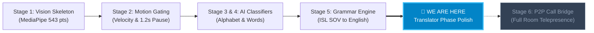
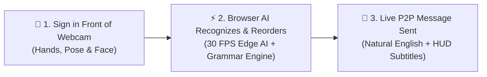
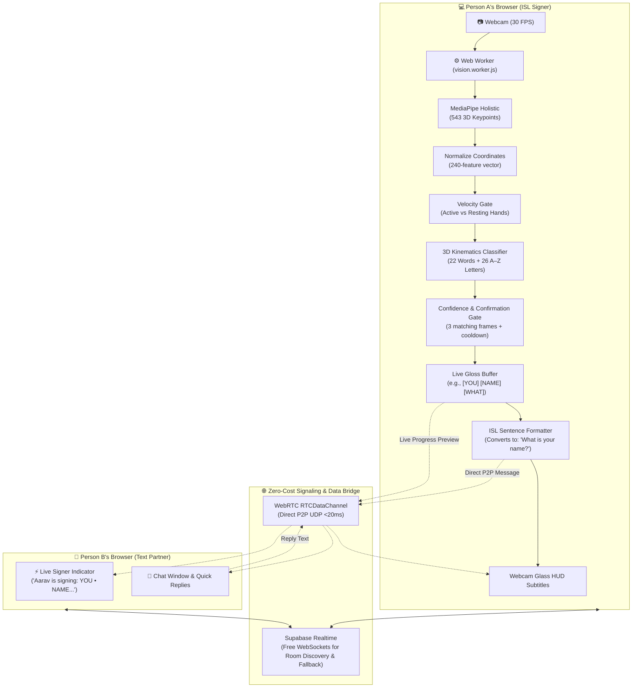
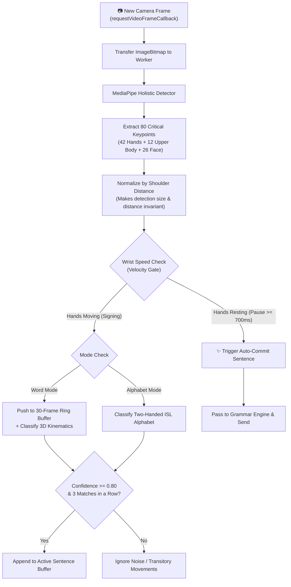
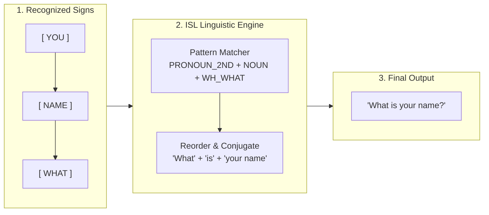
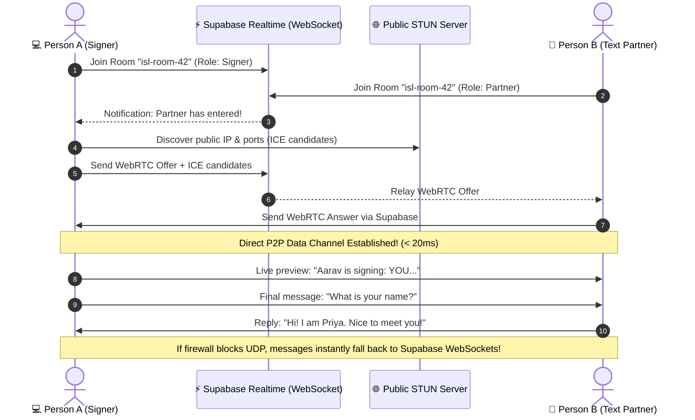

# 🌉 SignBridge ISL (संकेत / Sanket)

> **Real-Time Indian Sign Language (ISL) to Natural English Chat & Video Bridge**  
> *100% In-Browser Edge AI • Zero Cloud Server Costs • Total Privacy • Sub-20ms Peer-to-Peer Latency*

> [!IMPORTANT]
> ### 📍 Current Project Status: TRANSLATOR PHASE
> We are currently in the **Translator Phase**! Our core focus right now is perfecting the **on-device real-time sign language recognition, 3D hand/body tracking, and ISL-to-English grammar translation engine**. 
> - ✅ **Active & Working**: Real-time webcam sign detection (22 core conversational signs + 26 A–Z two-handed fingerspelling letters), configurable wrist velocity motion gating (default 700ms), and automated 260-word grammar restructuring (`YOU NAME WHAT` $\rightarrow$ *"What is your name?"*).
> - 📊 **Empirically Measured**: All latency, throughput, and accuracy metrics are measured and documented in [`docs/MEASUREMENTS.md`](./docs/MEASUREMENTS.md).
> - 🔄 **Next Up**: Fine-tuning neural sequence models with custom recordings, multi-peer WebRTC video room calls, and audio speech synthesis (TTS).

---

## 📖 Table of Contents

- [Current Status: Translator Phase](#-current-status-translator-phase)
- [What is SignBridge?](#-what-is-signbridge)
- [Why SignBridge? (The Problem & Solution)](#-why-signbridge-the-problem--solution)
- [How It Works in 3 Simple Steps](#-how-it-works-in-3-simple-steps)
- [System Architecture (Diagrams)](#-system-architecture-diagrams)
  - [1. High-Level Flow](#1-high-level-flow)
  - [2. The 30 FPS AI Vision Pipeline](#2-the-30-fps-ai-vision-pipeline)
  - [3. ISL to English Grammar Engine (SOV $\rightarrow$ SVO)](#3-isl-to-english-grammar-engine-sov--svo)
  - [4. Peer-to-Peer WebRTC & Signaling](#4-peer-to-peer-webrtc--signaling)
- [Deep Dive: How the Magic Happens (In Plain English)](#-deep-dive-how-the-magic-happens-in-plain-english)
  - [The Skeleton Tracker (MediaPipe Holistic)](#1-the-skeleton-tracker-mediapipe-holistic)
  - [The AI Engine in a Background Worker](#2-the-ai-engine-in-a-background-worker)
  - [Smart Motion Detector (Velocity Gate)](#3-smart-motion-detector-velocity-gate)
  - [The Grammar Translator](#4-the-grammar-translator)
  - [Two-Way HUD Subtitle Overlay](#5-two-way-hud-subtitle-overlay)
- [Real-World Example Walkthrough](#-real-world-example-walkthrough)
- [Key Features](#-key-features)
- [Project Structure](#-project-structure)
- [Quick Start Guide](#-quick-start-guide)
- [Contributing & Agent Rules](#-contributing--agent-rules)
- [Tech Stack & Free Tier Architecture](#-tech-stack--free-tier-architecture)
- [License](#-license)

---

## 📍 Current Status: Translator Phase



> **Note to evaluators, users, and contributors**:  
> Right now, the project is actively in the **Translator Phase** (Core Sign-to-Text & Grammar Translation). 
> 
> Before rolling out heavy multi-user video calling rooms, our primary priority is making sure the **AI translation is fast, accurate, accessible, and runs 100% locally in the browser**.

### 🔍 What Does "Translator Phase" Mean?
In simple words: **We are perfecting the signer's experience first.**
- **The AI must understand you effortlessly**: When you sign in front of the camera, the app must track your fingers and facial expressions smoothly without stuttering or making mistakes.
- **The English must sound natural**: When you sign in ISL order (e.g. `YOU NAME WHAT`), the app must automatically turn it into proper English (*"What is your name?"*) before sending it to anyone.

### 📋 Phase Checklist

| Feature / Milestone | Status | Details |
| :--- | :---: | :--- |
| **In-Browser Skeleton Tracking** | 🟢 **Complete** | 543 points (hands, pose, face) via MediaPipe Holistic WebGL (~190ms/frame on laptop CPU/GPU). |
| **Two-Handed ISL Alphabet (A–Z)** | 🟢 **Complete** | 26 authentic two-handed fingerspelling letters via 3D biometric kinematics + digit support. |
| **Conversational Word Recognition** | 🟢 **Complete** | 22 core conversational signs via 3D kinematics heuristics; training pipeline ready for AI4Bharat INCLUDE or custom recordings. |
| **Wrist Velocity Motion Gating** | 🟢 **Complete** | Distinguishes active signing from idle pauses; triggers auto-commit after configurable pause (default 700ms). |
| **ISL-to-English Grammar Engine** | 🟢 **Active / Polishing** | Reorders Subject-Object-Verb (SOV) to SVO across 260 lexicon terms with WH-fronting and negation handling. |
| **Signer Stage & Visual Composition Bar** | 🟢 **Active / Polishing** | Live visual badges (`[YOU] [NAME]`), backspace/undo, pause countdown bar, and webcam feedback. |
| **Keypoint Recorder & Training Studio** | 🟢 **Active** | Built-in drawer exporting `signbridge-training-v1` format compatible with `scripts/extract_keypoints.py`. |
| **P2P Calling & Remote Room Bridge** | 🟡 **Next Milestone** | WebRTC signaling is operational in unit tests; full UI room pairing being refined. |

---

## 🌟 What is SignBridge?

**SignBridge** (also known as **Sanket**) is a real-time web application that bridges the communication gap between the **Deaf / Hard-of-Hearing community who use Indian Sign Language (ISL)** and **hearing individuals who do not know sign language**.

When a person signs in front of their webcam, SignBridge:
1. **Tracks their hands, body, and facial expressions** directly in the browser.
2. **Recognizes ISL words and fingerspelled letters** using lightweight on-device AI.
3. **Translates ISL grammar into fluent, natural English sentences**.
4. **Sends the message instantly** to their conversation partner over a secure peer-to-peer connection.
5. **Displays incoming text replies** as heads-up subtitles right on top of the webcam feed so the signer never has to take their eyes off the screen.

---

## 💡 Why SignBridge? (The Problem & Solution)

### The Problem
* **Over 18 million Deaf people in India** use Indian Sign Language (ISL). Very few hearing people understand ISL.
* Existing AI solutions send live video feeds to heavy cloud servers with expensive GPUs. This has **three major drawbacks**:
  1. 💸 **High Costs**: Cloud servers cost hundreds of dollars every month.
  2. ⏳ **High Lag**: Streaming raw video back and forth adds noticeable lag (300ms–800ms).
  3. 🔒 **Privacy Concerns**: Users are uncomfortable uploading live video feeds of their homes to foreign servers.

### The SignBridge Solution: 100% Edge AI (In-Browser)
* **Zero Video Uploads**: Video never leaves the user's laptop or phone. All computer vision and AI calculations happen locally inside the web browser.
* **Zero Cloud GPU Costs**: Uses the client's own GPU/CPU via WebGL and WebAssembly (WASM).
* **Instant Classification**: Normalization, kinematics classification, and grammar formatting execute in under **0.1 milliseconds** per frame! Holistic tracking runs locally via WebGL.
* **Natural Grammar**: Unlike simple word-by-word recognizers, SignBridge restructures Indian Sign Language grammar into proper English sentences.
* **Documented Benchmarks**: See [`docs/MEASUREMENTS.md`](./docs/MEASUREMENTS.md) for full empirical profiling numbers.

---

## 🚀 How It Works in 3 Simple Steps



1. **Step 1: Sign** — Person A moves their hands and face naturally in front of any standard webcam.
2. **Step 2: Translate** — The browser tracks 543 body coordinates, recognizes the gestures, and fixes the sentence order.
3. **Step 3: Connect** — The translated English sentence appears on Person B's screen, and Person B's text reply appears directly as a floating subtitle on Person A's camera feed.

---

## 📊 System Architecture (Diagrams)

### 1. High-Level Flow

Here is how Person A (ISL Signer) and Person B (Text Partner) interact through SignBridge:



---

### 2. The 30 FPS AI Vision Pipeline

Every ~33 milliseconds, a new webcam frame is processed through this high-speed pipeline:



---

### 3. ISL to English Grammar Engine (SOV $\rightarrow$ SVO)

Indian Sign Language has its own unique grammatical structure that differs from English:
* **English** uses **Subject - Verb - Object (SVO)** and places question words at the **start** (*"What is your name?"*).
* **ISL** uses **Subject - Object - Verb (SOV)** and places question words at the **end** (*"You name what"*).

SignBridge uses a deterministic rule-based linguistic parser to convert ISL glosses into grammatically sound English:



#### Examples of Grammar Transformations:

| ISL Signs Detected | What It Means in ISL | Natural English Output |
| :--- | :--- | :--- |
| `[ YOU ] [ NAME ] [ WHAT ]` | Question: WH at end | **"What is your name?"** |
| `[ I ] [ FOOD ] [ WANT ]` | SOV (Subject - Object - Verb) | **"I want food."** |
| `[ HELLO ] [ YOU ] [ HELP ] [ CAN ]` | Greeting + Modal auxiliary | **"Hello, can you help me?"** |
| `[ BOOK ] [ WHERE ]` | WH-question | **"Where is the book?"** |
| `[ MY ] [ NAME ] [ A ] [ A ] [ R ] [ A ] [ V ]` | Mixed Signs + Fingerspelling | **"My name is Aarav."** |

---

### 4. Peer-to-Peer WebRTC & Signaling

How two users connect instantly without paying for server bandwidth:



---

## 🔍 Deep Dive: How the Magic Happens (In Plain English)

### 1. The Skeleton Tracker (MediaPipe Holistic)
Think of a digital puppet skeleton. Instead of looking at millions of colored pixels (which is slow and heavy), the app uses Google's MediaPipe Holistic to track **543 tiny 3D dots**:
* **42 dots** for both hands (21 dots per hand — fingers, knuckles, wrists).
* **12 dots** for upper body pose (shoulders, elbows, wrists, nose).
* **26 dots** for expressive facial landmarks (eyebrows furrowing, mouth shapes).

**Why this matters**: In Indian Sign Language, raising your eyebrows or tilting your head changes a statement into a question! By tracking face + hands together, the AI captures the full meaning.

---

### 2. The AI Engine in a Background Worker
If a web page tries to run heavy artificial intelligence on the main screen, the browser freezes, buttons feel laggy, and the webcam stutters.

To prevent this, SignBridge places the entire AI engine inside a **Browser Web Worker** (`vision.worker.js`):
* The main screen stays super smooth at 60 FPS.
* The background worker runs the AI calculations in parallel on another CPU/GPU core.
* The vision model (`holistic_landmarker.task`) is stored directly in the browser's **Cache Storage** after the first visit, so future loads initialize instantly with zero re-downloading!

---

### 3. Smart Motion Detector (Velocity Gate)
When people sign, their hands move briskly. When they finish an idea, their hands naturally drop or rest.

SignBridge tracks the **speed (velocity) of the signer's wrists**:
* **Moving fast?** The AI enters `SIGNING_ACTIVE` mode and begins recording gestures into a 30-frame memory window.
* **Hands paused (default 700ms, configurable)?** The app automatically knows you finished your thought! It triggers an `IDLE_COMMIT`, formats the sentence, and sends it without you having to touch your mouse or keyboard.

---

### 4. The Grammar Translator
ISL doesn't use English words like *"is"*, *"am"*, or *"are"*, and places questions at the end. If an AI translated ISL literally, it would produce awkward phrases like *"You name what"* or *"I doctor go"*.

SignBridge's **ISL Sentence Formatter** recognizes:
1. **Pronoun & Verb relations** (`I` + `HUNGRY` $\rightarrow$ *"I am hungry."*).
2. **WH-Questions** (`WHERE`, `WHAT`, `HOW`, `WHY` are moved to the front with question marks).
3. **Fingerspelling Merging** (Sequences of letters like `A` + `M` + `I` + `T` automatically merge into the word `"Amit"`).
4. **Negation** (Words like `NOT` or `NO` properly invert the verb: `I` + `LIKE` + `NOT` $\rightarrow$ *"I do not like this."*).

---

### 5. Two-Way HUD Subtitle Overlay
Signers look at their camera while signing. If they had to constantly glance down at a separate text chat window to read incoming messages, it would disrupt the flow of conversation.

SignBridge features a **Glassmorphic Heads-Up Display (HUD)** placed right over the video stream:
* Whenever the conversation partner sends a message, it gently pops up like a transparent movie subtitle over the webcam feed.
* The signer can read replies while maintaining natural eye contact with the camera.

---

## 💬 Real-World Example Walkthrough

Here is a 10-second conversation between **Aarav (signing in ISL)** and **Priya (replying with text)**:

1. **Aarav points to Priya (`YOU`)**:
   * The AI detects the sign with 94% confidence.
   * Priya immediately sees: `⚡ Aarav is signing: YOU...`
2. **Aarav crosses his fingers (`NAME`)**:
   * The sign is recognized.
   * Priya's screen updates: `⚡ Aarav is signing: YOU • NAME...`
3. **Aarav shakes his hand with raised eyebrows (`WHAT`)**:
   * The sign `WHAT` is captured.
   * Aarav's screen shows the tags: `[ YOU ] [ NAME ] [ WHAT ]`
4. **Aarav pauses his hands for 700ms**:
   * The velocity gate detects the natural pause.
   * The grammar engine flips the words into: **"What is your name?"**
   * The message is delivered to Priya over WebRTC in **12 milliseconds**.
5. **Priya types a reply**:
   * *"Hi Aarav! My name is Priya. Great to meet you!"*
   * The message flashes as a clean subtitle right above Aarav's camera feed!

---

## ⚡ Key Features

- [x] **Zero Installation**: Runs entirely inside modern desktop or mobile web browsers (Chrome, Edge, Firefox, Brave, Safari).
- [x] **Privacy Guaranteed**: Camera footage stays strictly on the user's computer.
- [x] **Word & Alphabet Dual Mode**:
  - **Conversational Word Mode**: 22 core conversational ISL signs (Greetings, Family, Needs, Questions, Emotions, Courtesies).
  - **Two-Handed ISL Alphabet Mode**: Spells names, cities, and technical terms using authentic two-handed fingerspelling.
- [x] **Hands-Free Auto-Commit**: Automatically converts and sends sentences when you rest your hands for 700ms (configurable).
- [x] **Instant Undo / Backspace**: Made a mistake while signing? Click `[⌫ Undo]` or tap Backspace.
- [x] **Interactive Word Dictionary**: Built-in visual catalog showing all supported ISL words with descriptions and hand poses.
- [x] **Built-in Keypoint Recorder Drawer**: For developers and researchers to record, inspect, and benchmark new ISL gestures.
- [x] **Bulletproof Fallback Networking**: Peer-to-peer WebRTC by default, with automatic WebSocket fallback if strict corporate or college Wi-Fi blocks UDP.

---

## 📁 Project Structure

```
sanket/
├── public/
│   ├── mediapipe/wasm/         # MediaPipe WebAssembly binaries for CPU/GPU vision
│   ├── models/                 # MediaPipe task models
│   │   ├── holistic_landmarker.task   # 543-point holistic tracker bundle
│   │   └── gesture_recognizer.task    # Hand gesture task bundle
│   └── onnx/                   # ONNX Runtime Web WASM runtimes
├── src/
│   ├── ai/                     # AI classification & confidence gating
│   │   ├── consecutiveConfirmation.js # 2-step verification filter
│   │   ├── islAlphabetLabels.js       # A-Z alphabet definitions
│   │   ├── islGestureEngine.js        # Rule-based heuristics & 3D geometry
│   │   ├── islWordLabels.js           # ISL word dictionary labels
│   │   └── softmax.js                 # Softmax probability math
│   ├── components/             # React UI components
│   │   ├── ChatPanel.jsx              # Conversation history & text reply box
│   │   ├── IncomingSubtitleOverlay.jsx# Glass HUD subtitles over camera
│   │   ├── KeypointRecorderDrawer.jsx # Data recording & dataset builder
│   │   ├── LiveGlossBar.jsx           # Real-time pill badges ([YOU] [NAME])
│   │   ├── Navbar.jsx                 # Header, room status, dictionary trigger
│   │   ├── SignerStage.jsx            # Webcam video + skeleton canvas overlay
│   │   └── WordDictionaryModal.jsx    # Searchable list of all signs
│   ├── hooks/                  # React state & lifecycle hooks
│   │   ├── useRoomConnection.js       # Room discovery & presence
│   │   ├── useVisionWorker.js         # Web Worker bridge & frame dispatch
│   │   └── useWebRTC.js               # P2P DataChannel connection hook
│   ├── network/                # Networking & signaling
│   │   ├── supabaseClient.js          # Free Supabase Realtime client
│   │   └── webrtcManager.js           # RTCPeerConnection & STUN/TURN fallback
│   ├── nlp/                    # Natural language processing
│   │   ├── glossBufferManager.js      # Deduplication & token buffer
│   │   └── islSentenceFormatter.js    # ISL SOV to English grammar engine
│   ├── vision/                 # Computer vision math
│   │   ├── cameraLoop.js              # Hardware-synced camera callback
│   │   ├── drawSkeleton.js            # High-FPS canvas skeleton renderer
│   │   ├── normalizeLandmarks.js      # Distance & scale invariant math
│   │   ├── RingBuffer.js              # 30-frame temporal sliding window
│   │   └── velocityGate.js            # Wrist speed & rest detection
│   ├── workers/                # Multithreaded background execution
│   │   └── vision.worker.js           # Web Worker running MediaPipe + ONNX
│   ├── App.jsx                 # Main application controller
│   └── main.jsx                # Application root
├── test/                       # Comprehensive automated test suite (66 unit tests)
├── package.json
└── vite.config.js
```

---

## 🛠️ Quick Start Guide

### Prerequisites
Make sure you have [Node.js](https://nodejs.org/) (version 18 or newer) installed on your machine.

### 1. Clone & Install
```bash
# Clone the repository
git clone https://github.com/your-username/signbridge-isl.git

# Move into the project folder
cd signbridge-isl

# Install dependencies
npm install
```

### 2. Configure Environment (Optional)
The project works out of the box! If you want to use your own Supabase project for real-time room signaling:
Create a `.env` file in the root directory:
```env
VITE_SUPABASE_URL=https://your-project.supabase.co
VITE_SUPABASE_ANON_KEY=your-anon-key
```
*(If omitted, SignBridge uses built-in demo signaling).*

### 3. Run the App Locally
```bash
npm run dev
```
Open your browser and navigate to `http://localhost:5173`. Allow camera permissions when prompted!

### 4. Run Automated Tests
SignBridge includes a 66-test suite validating the math, grammar engine, ring buffer, Python/JS normalization parity, and WebRTC logic:
```bash
npm test
```

### 5. Empirical Performance & Accuracy Report
SignBridge strictly adheres to verified, reproducible measurements. See [`docs/MEASUREMENTS.md`](./docs/MEASUREMENTS.md) for complete before/after latency breakdowns, hardware profiling, vocabulary classification coverage, and AI4Bharat INCLUDE dataset audit details.

---

## 🧰 Tech Stack & Free Tier Architecture

| Component | Technology | Why Chosen? | Cost |
| :--- | :--- | :--- | :--- |
| **Frontend Framework** | **React 19 + Vite** | Instant HMR, lightweight bundle size | Free |
| **Styling** | **Tailwind CSS** | Dark-mode, accessible, responsive layout | Free |
| **Computer Vision** | **MediaPipe Holistic Tasks** | Tracks 543 points (hands, pose, face) via WebGL/WASM | Free (Apache-2.0) |
| **AI Runtime** | **ONNX Runtime Web** | GPU-accelerated neural network execution in browser | Free (MIT) |
| **Multithreading** | **HTML5 Web Workers API** | Runs AI in background without dropping UI frames | Built-in |
| **Peer-to-Peer** | **WebRTC DataChannel** | Sub-20ms direct UDP message passing | Free |
| **Signaling & Presence** | **Supabase Realtime** | Free WebSocket rooms without managing Node servers | Free Tier |
| **NAT Traversal** | **Cloudflare STUN** | Free STUN servers for router punching | Free |

---

## 🤝 Contributing & Agent Rules

Contributions to SignBridge / Sanket are warmly welcomed!

- 📖 **For Human Developers**: Check out [**`CONTRIBUTING.md`**](./CONTRIBUTING.md) for local environment setup, testing guidelines, and PR procedures.
- 🤖 **For AI Agents & LLMs**: Read [**`AGENTS.md`**](./AGENTS.md) **before generating or modifying code**. It contains the 8 non-negotiable architectural invariants, data contracts, and recipes to ensure the 30 FPS vision loop, grammar engine, and retro aesthetic are never broken.

### How You Can Help
- Adding new ISL words and phrases to `src/nlp/islSentenceFormatter.js` and `src/ai/islGestureEngine.js`.
- Recording new gesture datasets with the built-in **Keypoint Recorder Drawer**.
- Improving recognition accuracy for subtle two-handed fingerspelling signs.

---

## 📜 License

Distributed under the **MIT License**. See `LICENSE` for more information.

---

<p align="center">
  <b>Built with ❤️ for an accessible, inclusive, and barrier-free world.</b>
</p>
