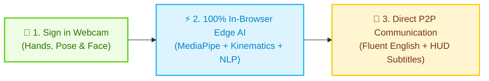
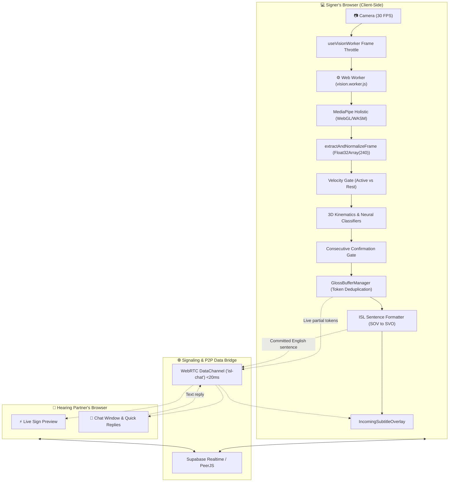
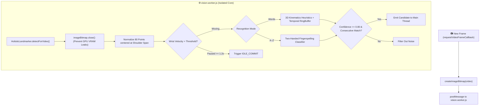
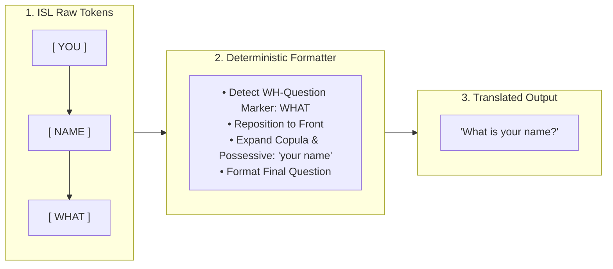
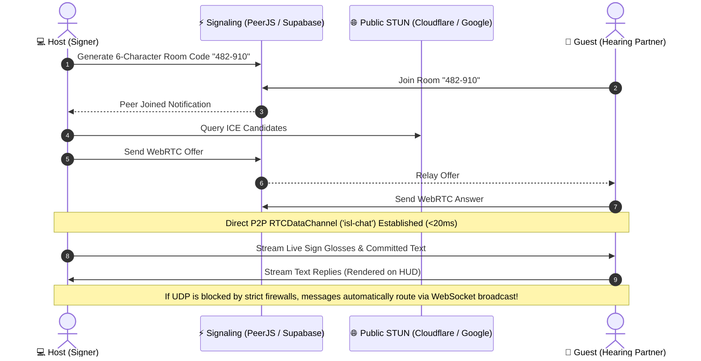

# 🌉 SignBridge ISL (संकेत / Sanket)

> **Real-Time Indian Sign Language (ISL) to Natural English Chat & Video Bridge**  
> *100% In-Browser Edge AI • Zero Cloud Server Costs • Total Privacy • Sub-20ms Peer-to-Peer Latency*

[](./test)
[](./LICENSE)
[](#-the-8-golden-invariants)
[](#2-the-ai-engine-in-a-background-worker)

---

## 📍 Table of Contents

- [What is SignBridge?](#-what-is-signbridge)
- [Why SignBridge? (The Problem & Edge Solution)](#-why-signbridge-the-problem--edge-solution)
- [The 5 Core Application Hubs](#-the-5-core-application-hubs)
  - [1. 🏠 Home Page (Minimal Choice Arena)](#1--home-page-minimal-choice-arena)
  - [2. 📖 Learn ISL Studio (7-Level Curriculum)](#2--learn-isl-studio-7-level-curriculum)
  - [3. 📹 Sign Call & P2P Video Lobby](#3--sign-call--p2p-video-lobby)
  - [4. 🎓 Teach Studio (Custom Gesture Training)](#4--teach-studio-custom-gesture-training)
  - [5. 🧪 Testing Arena (Live Benchmark & Quiz)](#5--testing-arena-live-benchmark--quiz)
- [The 8 Golden Invariants](#-the-8-golden-invariants)
- [System Architecture & Flow Diagrams](#-system-architecture--flow-diagrams)
  - [1. High-Level Flow](#1-high-level-flow)
  - [2. 30 FPS Off-Main-Thread AI Vision Pipeline](#2-30-fps-off-main-thread-ai-vision-pipeline)
  - [3. ISL to English Grammar Engine (SOV $\rightarrow$ SVO)](#3-isl-to-english-grammar-engine-sov--svo)
  - [4. Dual-Transport WebRTC Signaling](#4-dual-transport-webrtc-signaling)
- [✨ Built-in Smart Tools](#-built-in-smart-tools)
  - [Ask AI Guide (BYOK Multi-Model Assistant)](#-ask-ai-guide-byok-multi-model-assistant)
  - [In-App Feedback & Window Snapshot Tool](#-in-app-feedback--window-snapshot-tool)
  - [System & Contributor Panel](#-system--contributor-panel)
- [Repository Topology](#-repository-topology)
- [Quick Start Guide](#-quick-start-guide)
- [Tech Stack](#-tech-stack)
- [Contributing & Attribution Protocol](#-contributing--attribution-protocol)
- [License](#-license)

---

## 🌟 What is SignBridge?

**SignBridge ISL** (also known as **Sanket / संकेत**) is an on-device, privacy-preserving communication bridge connecting the **Deaf and Hard-of-Hearing community who use Indian Sign Language (ISL)** with **hearing individuals**.

SignBridge executes entirely inside modern client web browsers via **WebGL**, **WebAssembly (WASM)**, and **HTML5 Web Workers**. No camera stream, joint coordinate tensor, or image bitmap is ever uploaded to a remote cloud server.



---

## 💡 Why SignBridge? (The Problem & Edge Solution)

### The Problem
* **Over 18 million Deaf people in India** communicate through Indian Sign Language (ISL), yet very few hearing people understand sign language.
* Traditional AI computer vision solutions stream raw camera feeds to cloud servers hosting expensive GPU clusters. This introduces:
  1. 💸 **High Recurring Costs**: Thousands of dollars in cloud GPU compute bills every month.
  2. ⏳ **High Latency**: Network round-trip delays (300ms–1,000ms) that make natural two-way conversation feel disconnected.
  3. 🔒 **Privacy Concerns**: Users must transmit live video feeds of their private spaces to third-party servers.

### The SignBridge Edge Solution
* 🔒 **100% Edge Privacy**: Video frames remain strictly inside client browser memory and are discarded after inference.
* ⚡ **Sub-20ms P2P Latency**: Direct browser-to-browser WebRTC UDP data channels stream partial signing tokens and natural English translations instantly.
* 🆓 **Zero Infrastructure Costs**: Runs on standard consumer laptops and phones via WebGL/WASM acceleration; signaling operates over free-tier WebSockets with an automatic cross-tab fallback.
* 🧠 **Deterministic Grammar Transformation**: ISL Subject-Object-Verb (SOV) order and trailing WH-question markers are reordered into fluent Subject-Verb-Object (SVO) English sentences without hallucinations.

---

## 🗂️ The 5 Core Application Hubs

SignBridge is structured into five dedicated, tactile interfaces:

### 1. 🏠 Home Page (Minimal Choice Arena)
- Designed around the friendly Otter mascot **Sanket**.
- Two primary action cards: **Learn ISL** (interactive curriculum) and **Sign Call** (code-based video bridge).
- Direct access to the **Teach** studio and **Testing** arena.
- Floating **Ask AI** assistant launcher.

### 2. 📖 Learn ISL Studio (7-Level Curriculum)
- **1,000+ Sign Catalog**: Progressive structured course levels from **Foundations** (greetings, courtesies) to **Expert** (emergency, medical, governance).
- **Live Anatomical Posture Guide**: Real-time biometric alignment check measuring wrist Euclidean distances, finger extensions, and joint angles against target ISL kinematics.
- **Muscle Memory Pass Criteria**: Requires 3 successful consecutive repetitions to master each sign.
- **Sign Academy Drawer**: Searchable curriculum directory filtered by category and mastery status.

### 3. 📹 Sign Call & P2P Video Lobby
- **6-Character Call Codes**: Room pairing via simple codes (`?join=CODE`) without user account registration.
- **Dual-Transport Bridge**: Direct WebRTC UDP `RTCDataChannel("isl-chat")` with automatic WebSocket broadcast fallback.
- **Heads-Up Subtitle Overlay (`IncomingSubtitleOverlay`)**: Hearing partner text replies appear directly as transparent subtitles over the webcam feed so signers maintain eye contact.
- **Dual-Camera Grid**: View local and remote camera feeds side-by-side or focus on either participant.

### 4. 🎓 Teach Studio (Custom Gesture Training)
- Record your own sign variations and custom gestures directly in the browser.
- **Guided Training Sets**: Step-by-step recording workflows for the 26 A–Z letters and core conversational words.
- Dynamic DTW/Euclidean trajectory matching for user-trained gestures.
- Export and import trained sign sets as JSON for data sharing.

### 5. 🧪 Testing Arena (Live Benchmark & Quiz)
- **100+ Testable Signs**: Combines built-in neural and geometric classifiers with user-taught custom signs.
- **Live View Mode**: Real-time continuous detection readouts with candidate rankings.
- **Timed Quiz Challenge**: 10-question rounds with countdown timer, streak tracker, instant pass/fail feedback, and final accuracy scoring.

---

## 🛡️ The 8 Golden Invariants

All automated agents, contributors, and core updates **must strictly satisfy** these 8 architectural invariants:

```
┌────────────────────────────────────────────────────────────────────────┐
│                        THE 8 GOLDEN INVARIANTS                         │
├────────────────────────────────────────────────────────────────────────┤
│ 1. ZERO BACKEND SERVERS        │ 100% client-side edge execution        │
│ 2. OFF-MAIN-THREAD AI          │ MediaPipe & ONNX strictly in Worker    │
│ 3. 240-FLOAT NORMALIZATION     │ Uniform Float32Array(240); zero NaN    │
│ 4. TEMPORAL MOTION GATING      │ 30-frame window; 1.2s auto-commit pause│
│ 5. CONFIRMATION HYSTERESIS     │ Multi-frame debounce; lock until reset │
│ 6. DETERMINISTIC LINGUISTICS   │ LING-01 to LING-04 contracts unbroken  │
│ 7. DUAL-TRANSPORT NETWORKING   │ P2P WebRTC + Supabase / BroadcastChan  │
│ 8. RETRO TACTILE DESIGN SYSTEM │ 0px border-radius; Windows 3D bevels   │
└────────────────────────────────────────────────────────────────────────┘
```

1. **Zero Backend Servers**: No external Python, Node, or cloud inference API for recognition or translation.
2. **Off-Main-Thread AI**: MediaPipe and ONNX execute exclusively inside `src/workers/vision.worker.js`. The main React UI thread only consumes message events.
3. **240-Float Normalization Contract**: Every frame is centered at the shoulder midpoint and scaled by shoulder span:
   - 21 Left Hand $\times$ 3 = 63 floats (0–62)
   - 21 Right Hand $\times$ 3 = 63 floats (63–125)
   - 12 Upper Pose $\times$ 3 = 36 floats (126–161)
   - 26 Facial Mesh $\times$ 3 = 78 floats (162–239)
   - Missing points are padded with `0.0`. `NaN` or `undefined` is strictly forbidden.
4. **Temporal Motion Gating**: 30-frame sliding `RingBuffer`. `VelocityGate` tracks rolling wrist movement (`IDLE` $\rightarrow$ `SIGNING_ACTIVE` $\rightarrow$ `PAUSE_COUNTDOWN` $\rightarrow$ `IDLE_COMMIT`). A 1.2s rest triggers auto-commit.
5. **Confirmation Hysteresis**: Signs require consecutive frames meeting the confidence threshold ($\ge 0.80$) with `lockUntilRelease: true` to prevent repetitive token spamming.
6. **Deterministic Linguistic Contracts**:
   - `LING-01`: Deduplicates adjacent identical tokens.
   - Contiguous fingerspelled letters merge into single words (`'S' + 'A' + 'N' + 'K' + 'E' + 'T'` $\rightarrow$ `'SANKET'`).
   - `LING-02`: Manual `.undo()` and `.clear()` support.
   - `LING-03`: Reorders ISL SOV to English SVO.
   - `LING-04`: Repositions trailing WH-questions to the front with appropriate copulas.
7. **Dual-Transport Networking**: Primary transport: WebRTC DataChannel (<20ms UDP). Secondary fallback: WebSocket broadcast. Offline / test fallback: browser `BroadcastChannel`.
8. **Retro Tactile Design System**: Strict 0px border-radius where retro classes apply, authentic 3D outset/inset bevels, and warm friendly palette (`#EDF7EC`, `#58CC02`, `#1CB0F6`, `#FFC800`, `#CE82FF`).

---

## 📊 System Architecture & Flow Diagrams

### 1. High-Level Flow



---

### 2. 30 FPS Off-Main-Thread AI Vision Pipeline



---

### 3. ISL to English Grammar Engine (SOV $\rightarrow$ SVO)

ISL naturally uses **Subject - Object - Verb (SOV)** and places question markers at the end. The linguistic engine translates these deterministically:



#### Grammar Transformation Reference:

| ISL Token Sequence | Grammatical Rule Applied | English Translated Output |
| :--- | :--- | :--- |
| `['YOU', 'NAME', 'WHAT']` | Trailing WH-question fronted + copula expansion | **"What is your name?"** |
| `['I_ME', 'WATER', 'WANT']` | Subject-Object-Verb (SOV) $\rightarrow$ English SVO | **"I want water."** |
| `['HOSPITAL', 'WHERE']` | Location inquiry fronted | **"Where is the hospital?"** |
| `['I_ME', 'FOOD', 'EAT', 'NO']` | Negative particle integrated into auxiliary | **"I do not eat food."** |
| `['I_ME', 'NAME', 'S', 'A', 'N', 'K', 'E', 'T']` | Contiguous letters merged into proper noun | **"My name is Sanket."** |
| `['NAMASTE']` | Standalone cultural greeting | **"Namaste!"** |

---

### 4. Dual-Transport WebRTC Signaling



---

## ✨ Built-in Smart Tools

### 🤖 Ask AI Guide (BYOK Multi-Model Assistant)
- Access via the floating bottom launcher or mobile navigation dock.
- **Multi-Provider Support**: Compatible with Google Gemini (`gemini-2.5-flash`), Groq, OpenRouter, and OpenAI.
- **Contextual Screen Awareness**: Analyzes the current active stage, selected signs, camera state, and error conditions.
- **Voice AI Mode**: Real-time voice interaction with spoken responses.
- **Transcript Export**: Export conversations in formatted Plain Text (`.txt`) or Word Document (`.doc`).

### 🐞 In-App Feedback & Window Snapshot Tool
- Trigger via the **FEEDBACK** button in the navbar.
- Automatically captures a high-resolution DOM snapshot of the current window.
- **Canvas Annotation**: Draw circles, arrows, and highlights over the screenshot before submission.
- **Edge Telemetry**: Captures client browser specs, WebGL acceleration status, camera FPS, and worker latency.
- Generates pre-formatted GitHub issues or email reports.

### 🛡️ System & Contributor Panel
- Accessible via the navbar 3-dot overflow menu (`⋮` $\rightarrow$ `ℹ About & Diagnostics`).
- View official Git repository links and clone commands.
- Review the **Pull Request Attribution Protocol**.
- **Developer App Cache Reset**: One-click reset for local storage, session storage, CacheStorage, and IndexedDB.

---

## 📁 Repository Topology

```
sanket/
├── public/
│   ├── _headers                        # COOP/COEP headers for WASM SharedArrayBuffer
│   ├── mediapipe/wasm/                 # Google MediaPipe WASM binaries & loaders
│   ├── models/
│   │   ├── holistic_landmarker.task   # MediaPipe Holistic bundle (hands + pose + face)
│   │   ├── isl_alphabet_mlp.onnx       # A–Z ISL fingerspelling neural net
│   │   └── isl_include_50.onnx         # 50-word temporal sequence model
│   └── onnx/                           # ONNX Runtime Web WASM SIMD & thread workers
├── src/
│   ├── ai/
│   │   ├── consecutiveConfirmation.js  # Hysteresis confirmation gate
│   │   ├── islAlphabetLabels.js        # 26 ISL fingerspelling letter metadata
│   │   ├── islCourseCurriculum.js      # 7-level progressive learning curriculum
│   │   ├── islGestureEngine.js         # 3D biometric joint & kinematics classifier
│   │   ├── islTargetLandmarks.js       # Target landmark models & evaluation rules
│   │   ├── islWordLabels.js            # 1,000+ ISL vocabulary taxonomy
│   │   └── softmax.js                  # Stable softmax & top-k ranker
│   ├── components/
│   │   ├── AboutModal.jsx              # System properties, invariants & cache clear
│   │   ├── CallLobby.jsx               # Code-based 6-character room lobby
│   │   ├── ChatPanel.jsx               # Text messenger window + quick reply chips
│   │   ├── FeedbackModal.jsx           # Screenshot capture, drawing & issue reporter
│   │   ├── HomeChatbotPopup.jsx        # BYOK multi-provider AI assistant
│   │   ├── HomePage.jsx                # Choice arena & animated Otter illustrations
│   │   ├── HowItWorksModal.jsx         # Interactive architecture & gesture guide
│   │   ├── IncomingSubtitleOverlay.jsx # Closed-captioning HUD over webcam
│   │   ├── KeypointRecorderDrawer.jsx  # Gesture dataset recorder & benchmark tool
│   │   ├── LearnGuessPanel.jsx         # Live AI detection readout & rep tracker
│   │   ├── LearnSidebar.jsx            # Sign Academy curriculum drawer
│   │   ├── LearnStage.jsx              # Video viewport + 60fps skeleton canvas
│   │   ├── MobileBottomNav.jsx         # Mobile navigation dock
│   │   ├── Navbar.jsx                  # Header, navigation tabs, 3-dot overflow menu
│   │   ├── SignerStage.jsx             # In-call dual-camera video grid
│   │   ├── TeachStage.jsx              # Custom gesture recording & training studio
│   │   ├── TestStage.jsx               # Benchmark live view & timed quiz mode
│   │   └── WordDictionaryModal.jsx     # Interactive ISL visual dictionary
│   ├── hooks/
│   │   ├── useRoomConnection.js        # Room ID routing & presence state
│   │   ├── useVisionWorker.js          # Web Worker lifecycle & frame bridge
│   │   └── useWebRTC.js                # WebRTC state machine & dual transport
│   ├── network/
│   │   ├── supabaseClient.js           # Supabase Realtime + BroadcastChannel fallback
│   │   └── webrtcManager.js            # PeerConnection + DataChannel manager
│   ├── nlp/
│   │   ├── glossBufferManager.js       # Token deduplication & fingerspelling merger
│   │   └── islSentenceFormatter.js     # Deterministic SOV -> SVO grammar engine
│   ├── vision/
│   │   ├── cameraLoop.js               # Hardware-synced requestVideoFrameCallback
│   │   ├── drawSkeleton.js             # Canvas renderer & boundary alerts
│   │   ├── normalizeLandmarks.js       # 240-float shoulder-relative normalization
│   │   ├── RingBuffer.js               # 30-frame temporal FIFO buffer
│   │   └── velocityGate.js             # Wrist velocity & 1.2s auto-commit pause
│   ├── workers/
│   │   └── vision.worker.js            # Off-main-thread vision & AI inference
│   ├── App.jsx                         # Main state coordinator & page router
│   ├── index.css                       # Design system CSS & tokens
│   └── main.jsx                        # React root entry point
├── test/                               # Native node:test suite (144 passing tests)
├── package.json                        # Scripts & dependencies
└── vite.config.js                      # Vite + ES Worker + COOP/COEP config
```

---

## 🛠️ Quick Start Guide

### Prerequisites
- [Node.js](https://nodejs.org/) (version 18 or newer)
- A modern desktop or mobile browser supporting WebGL and WebAssembly (Chrome, Edge, Firefox, Brave, Safari).

### 1. Clone & Install
```bash
# Clone the repository
git clone https://github.com/vickysahuhere/signbridge.git

# Move into the project directory
cd signbridge

# Install dependencies
npm install
```

### 2. Configure Environment (Optional)
The application works immediately out of the box with built-in offline fallbacks! To enable optional cloud signaling or AI Chatbot features, copy `.env.example` to `.env`:

```env
# Optional: Google Gemini API Key for Ask AI Guide
# Get a free key at https://aistudio.google.com/app/apikey
VITE_GEMINI_API_KEY=your_gemini_api_key

# Optional: Supabase Realtime for global cross-network room discovery
VITE_SUPABASE_URL=https://your-project.supabase.co
VITE_SUPABASE_ANON_KEY=your_supabase_anon_key
```

### 3. Run Locally
```bash
npm run dev
```
Open `http://localhost:5173` in your browser and allow camera permissions when prompted.

### 4. Run Automated Tests
SignBridge includes a **144-test unit test suite** validating computer vision normalization, 3D kinematics, temporal motion gating, linguistic grammar restructuring, WebRTC packet schemas, and chatbot services:

```bash
npm test
```

### 5. Production Build
```bash
npm run build
```

---

## 🧰 Tech Stack

| Layer | Technology | Role & Why Chosen | Cost |
| :--- | :--- | :--- | :--- |
| **Framework** | **React 19 + Vite 6** | Ultra-fast HMR, concurrent rendering, minimal bundle size | Free (MIT) |
| **Styling** | **Tailwind CSS** | Tactile Duolingo / retro design system | Free (MIT) |
| **Computer Vision** | **MediaPipe Holistic Tasks** | 543 3D landmark points (hands, pose, face) via WebGL/WASM | Free (Apache-2.0) |
| **Inference Runtime** | **ONNX Runtime Web** | Local client-side neural network execution | Free (MIT) |
| **Concurrency** | **HTML5 Web Workers** | Off-main-thread vision pipeline maintaining 60 FPS UI | Built-in |
| **P2P Transport** | **WebRTC RTCDataChannel** | Sub-20ms direct UDP message streaming | Free |
| **Signaling** | **PeerJS + Supabase Realtime** | Free room discovery with local BroadcastChannel fallback | Free Tier |
| **STUN Discovery** | **Cloudflare & Google STUN** | Free public NAT traversal | Free |
| **Icons** | **Lucide React** | Clean, accessible stroke icons | Free (ISC) |

---

## 🤝 Contributing & Attribution Protocol

Contributions from developers, linguists, and researchers are warmly welcomed!

- 📖 **Human Contributors**: See [**`CONTRIBUTING.md`**](./CONTRIBUTING.md) for code standards, component styling rules, and pull request procedures.
- 🤖 **AI Agents & LLMs**: Consult [**`AGENTS.md`**](./AGENTS.md) **before making changes**. It defines the 8 Golden Invariants, normalization contracts, and test gate requirements.

### Pull Request Attribution Protocol
When submitting pull requests, explicitly claim your contribution in the PR description:
```text
"This contribution was developed by me (@your-handle)."
```

---

## 📜 License

Distributed under the **MIT License**. See [`LICENSE`](./LICENSE) for details.

<p align="center">
  <b>Built with ❤️ for an accessible, inclusive, and barrier-free world.</b>
</p>
