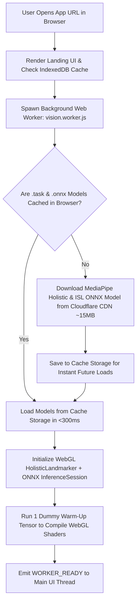
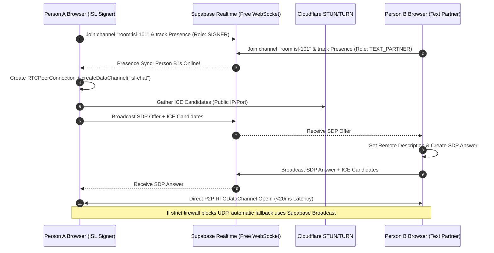

# Complete End-to-End Application Flow (`appflow.md`)

**Project**: SignBridge ISL — Real-Time Indian Sign Language (ISL) to Text Chat Application  
**Language**: JavaScript (ES6+ Modules, Web Workers, WebRTC, Supabase Realtime)

---

## 1. High-Level System State Machine

The application operates across **5 synchronized runtime flows**:
1. **Boot & Model Caching Flow**: Progressive loading of MediaPipe Holistic & ONNX ISL weights into browser `IndexedDB` / Cache Storage.
2. **Room Matchmaking & WebRTC Handshake Flow**: Connecting Person A and Person B via Supabase Realtime + STUN/TURN.
3. **30 FPS Vision & Motion-Gated Inference Flow**: Converting webcam frames into 3D normalized landmarks and ISL word/alphabet predictions inside a Web Worker.
4. **ISL SOV-to-English Sentence Formation Flow**: Buffering recognized ISL glosses, detecting a 1.2s hand pause, reordering grammar, and broadcasting to Person B.
5. **Two-Way Reply & HUD Subtitle Flow**: Delivering Person B's typed text back to Person A's webcam HUD.

---

## 2. Flow 1: Application Boot, Camera Permission & Model Caching

When Person A opens the web app, we load the AI models in the background inside `vision.worker.js` so the main UI renders in under 200ms.



> **Learning Takeaway (Why Warm-Up Matters in JS)**:  
> The very first time `onnxruntime-web` or MediaPipe runs on WebGL, the browser compiles GPU shaders, which takes ~400ms. By running a dummy array of zeros (`new Float32Array(7200)`) during initial boot, the first real webcam sign runs in **<8ms** with zero stutter!

---

## 3. Flow 2: Room Join & WebRTC Peer-to-Peer Connection Flow

How Person A (ISL Signer) and Person B (Text User) establish a private, zero-server-cost communication bridge:



---

## 4. Flow 3: Real-Time 30 FPS Webcam to ISL Gloss Recognition Loop

This loop executes every ~33ms inside Person A's browser while their camera is active:

```mermaid
flowchart TD
    Frame[Webcam New Frame @ 30 FPS via requestVideoFrameCallback] --> SendWorker[Transfer Frame ImageBitmap to vision.worker.js]
    SendWorker --> MP[MediaPipe HolisticLandmarker.detectForVideo]
    MP --> Draw[Send 2D Skeleton Coordinates to Main Thread Canvas Overlay]
    MP --> Norm[Extract 80 Landmarks: 42 Hand + 12 Pose + 26 Face]
    Norm --> Center[Normalize by Shoulder Midpoint & Shoulder Width Scale]
    Center --> Vel{Check Wrist Velocity Over Last 5 Frames}

    Vel -- "Velocity < Idle Threshold (Hands Resting)" --> IdleCheck{Idle Duration >= 1.2s & Buffer Non-Empty?}
    IdleCheck -- Yes --> TriggerCommit[Emit COMMIT_SENTENCE Event to Sentence Formatter]
    IdleCheck -- No --> WaitNext[Wait for Next Frame]

    Vel -- "Velocity >= Active Threshold (Signing)" --> ModeCheck{Current Recognition Mode?}
    
    ModeCheck -- "ISL Word Mode" --> PushBuf[Push 240 Floats into 30-Frame Sliding Ring Buffer]
    PushBuf --> StepCheck{Is Buffer Full (30 Frames) & Frame Step % 5 == 0?}
    StepCheck -- No --> WaitNext
    StepCheck -- Yes --> RunWordONNX[Run ISL Word Model via onnxruntime-web]
    
    ModeCheck -- "ISL Alphabet Mode (A-Z)" --> RunAlphaONNX[Run 2-Hand 42-Keypoint Alphabet MLP on Current Frame]

    RunWordONNX --> ConfGate{Top-1 Softmax Confidence >= 0.75 across 2 Consecutive Steps?}
    RunAlphaONNX --> ConfGate

    ConfGate -- No --> WaitNext
    ConfGate -- Yes --> Dedupe{Is Predicted Sign != Last Added Sign in Active Phrase?}
    Dedupe -- No --> WaitNext
    Dedupe -- Yes --> EmitGloss[Append Sign to Active Gloss Buffer & Broadcast Live Preview to Person B]
```

---

## 5. Flow 4: Concrete End-to-End Walkthrough (Example Conversation)

Here is the exact millisecond-by-millisecond lifecycle of a real interaction between **Person A (Aarav, using ISL)** and **Person B (Priya, using text)**:

### Step 1: Aarav Signs 3 ISL Words (`YOU` $\rightarrow$ `NAME` $\rightarrow$ `WHAT`)
1. **`t = 0.0s – 0.9s`**: Aarav points toward the camera (`YOU`).
   * `vision.worker.js` detects wrist velocity rising above threshold, buffers 30 normalized frames, and outputs `{ gloss: "YOU", confidence: 0.94 }`.
   * Aarav's UI adds a green pill `[ YOU ]` to the composition bar.
   * Over the WebRTC `RTCDataChannel`, Priya's screen immediately displays: *"⚡ Aarav is signing: YOU..."*
2. **`t = 1.1s – 2.0s`**: Aarav places two fingers (index and middle) of both hands tapping crosswise (`NAME` in ISL).
   * The sliding window classifies `{ gloss: "NAME", confidence: 0.89 }`.
   * Aarav's composition bar updates to `[ YOU ] [ NAME ]`.
   * Priya's live indicator updates to: *"⚡ Aarav is signing: YOU • NAME..."*
3. **`t = 2.2s – 3.1s`**: Aarav performs the ISL sign for `WHAT` (shaking index/open hand side-to-side with furrowed eyebrows).
   * Because facial landmarks (eyebrows) + hand trajectory are included in our 80 keypoints, the model predicts `{ gloss: "WHAT", confidence: 0.91 }`.
   * Composition bar shows `[ YOU ] [ NAME ] [ WHAT ]`.

### Step 2: 1.2-Second Pause Triggers Grammar Conversion & Auto-Send
4. **`t = 3.1s – 4.3s`**: Aarav lowers his hands to rest for `1.2 seconds`.
   * The wrist velocity detector triggers `COMMIT_SENTENCE` with the array `["YOU", "NAME", "WHAT"]`.
   * `islSentenceFormatter.js` detects the ISL WH-final question structure (`PRONOUN_2ND + NOUN + WH_WHAT`) and transforms it into: **`"What is your name?"`**
   * A `CHAT_MESSAGE` packet `{ id: "msg_1", sender: "Aarav", glosses: ["YOU", "NAME", "WHAT"], text: "What is your name?", timestamp: "21:15" }` is sent over `RTCDataChannel` to Priya.
   * Both chat logs display `"What is your name?"` (with a subtle badge showing the original ISL glosses `YOU • NAME • WHAT`).

### Step 3: Priya Replies via Text & Aarav Reads on the Webcam HUD
5. **`t = 6.0s`**: Priya types `"Hi Aarav! My name is Priya. Nice to meet you!"` and presses `Enter`.
   * The JSON message travels across `RTCDataChannel` in `15ms` to Aarav's browser.
   * On Aarav's screen, the message appears inside the **Top Glass HUD Subtitle Banner** directly over the top edge of his webcam feed—allowing him to read it immediately while keeping his eyes toward the camera to sign his next response!

---

## 6. Edge-Case & Error Recovery Flows

| Edge Case | What Happens Technically | How the App Handles It Gracefully |
| :--- | :--- | :--- |
| **One or both hands leave the camera frame** | `leftHandLandmarks` or `rightHandLandmarks` returns `undefined`. | `normalizeLandmarks.js` zero-pads the missing 21 joints (`0.0`) so ONNX never crashes, and the canvas border glows amber with `"Keep both hands inside frame"`. |
| **False-positive sign during hand transition** | Transitioning from Sign 1 to Sign 2 briefly resembles another sign. | **2-Step Consecutive Confirmation + 0.75 Confidence Gate** rejects 1-frame spikes; if a wrong word slips in, User A clicks `[⌫ Undo]` or shakes one hand rapidly above the shoulder to pop the last word. |
| **Out-of-Vocabulary Word (e.g., a city or person's name)** | The word is not in the 50/263 INCLUDE word list. | User A clicks `[A–Z Spell Mode]` (or holds a steady peace/V sign for 1 second to toggle modes) and spells the word using two-handed ISL alphabets. |
| **Strict Firewall Blocks WebRTC P2P UDP** | `RTCPeerConnection.connectionState` transitions to `'failed'` or `'disconnected'`. | `webrtcManager.js` automatically routes `sendMessage()` through `supabaseChannel.send({ type: 'broadcast' })` over port 443 HTTPS WebSockets with zero interruption. |
